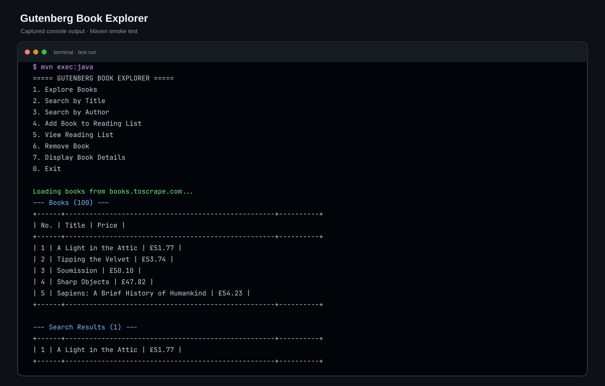
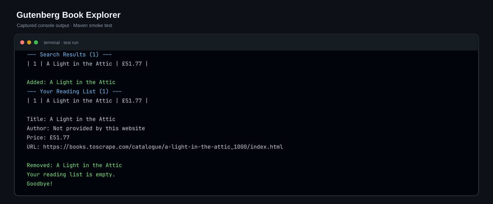

# Gutenberg Book Explorer

A small console application that scrapes a sample book catalog, lets you search titles, and manage a temporary reading list.

> **Data source note:** Despite the project name, the current code reads from [Books to Scrape](https://books.toscrape.com/), a demo storefront. It displays book titles and prices; author information is not available from the site's catalog pages, so author search is currently unsupported.


## Run

From the project directory, start the application with:

```bash
mvn exec:java
```

Maven compiles the source code and runs `com.student.App`. To compile without starting the interactive menu, use:

```bash
mvn compile
```

## Use the menu

The application provides these options:

1. **Explore Books** — load and display up to 100 books from the first five catalog pages.
2. **Search by Title** — find titles containing the entered text, without case sensitivity.
3. **Search by Author** — displays a message that author data is unavailable from the current source.
4. **Add Book to Reading List** — add a book from the most recent explore or title-search results.
5. **View Reading List** — show saved selections for the current run.
6. **Remove Book** — remove a selection from the current reading list.
7. **Display Book Details** — show the title, price, and catalog URL for a book in the latest results.
0. **Exit** — close the application.

The reading list is kept in memory and is cleared when the application exits. Catalog loading requires an internet connection.

## Screenshots

These images show excerpts from the captured console run, including catalog loading, title search, book details, and reading-list actions.






